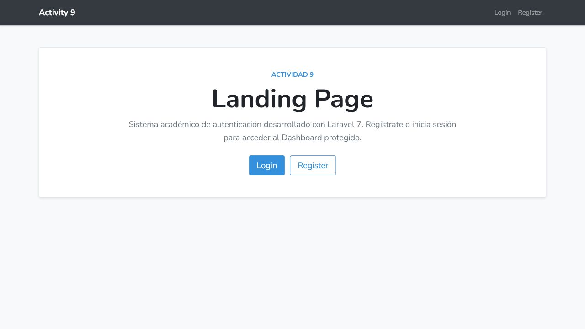
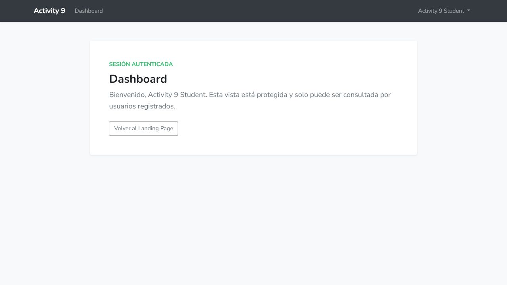
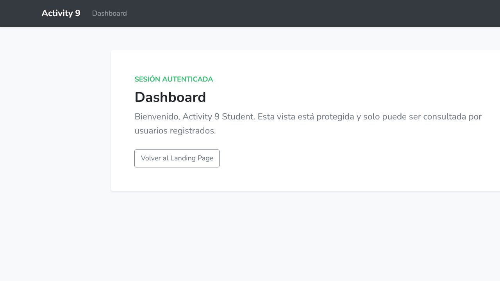
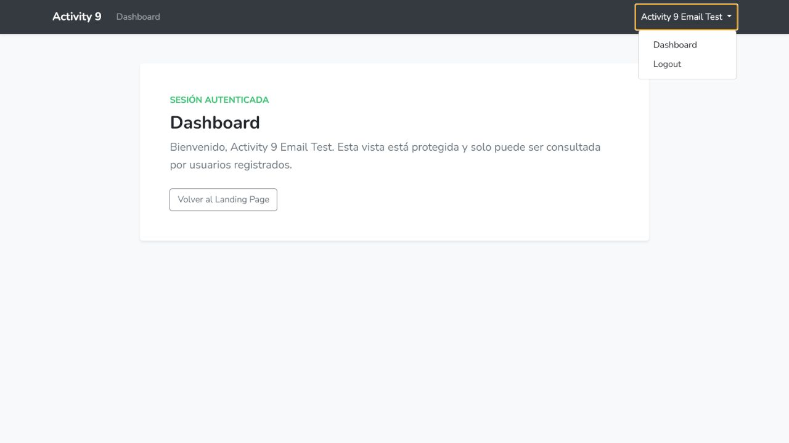
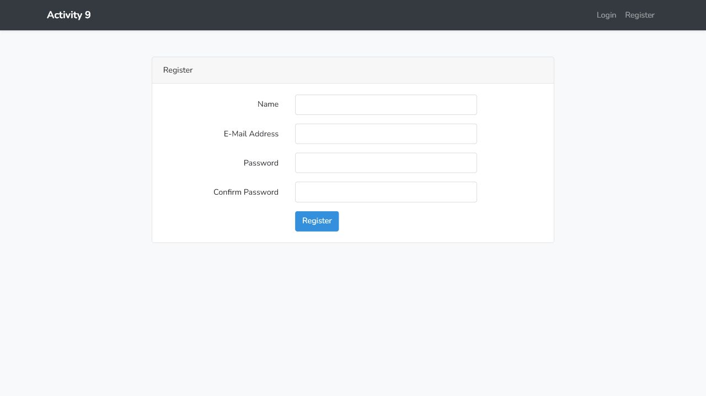
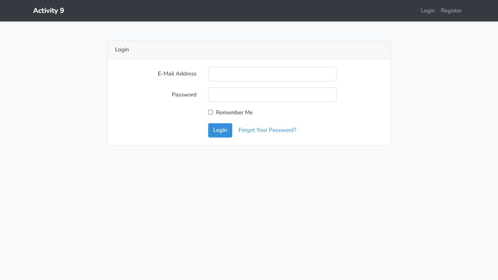

# Actividad 9

## Objetivo

Crear un sistema Laravel 7 con autenticación de usuarios, una Landing Page pública y un Dashboard protegido. La aplicación debe mostrar opciones diferentes en el navbar según el estado de la sesión e impedir que un invitado consulte el Dashboard.

## Tecnologías

- PHP 7.4.29.
- Laravel 7.30.7.
- Laravel UI 2.4.
- MySQL/MariaDB.
- Blade.
- Vue scaffolding y Bootstrap 4.
- PHPUnit 9.6.38.

## Autenticación

Laravel UI proporciona los formularios y rutas de registro, login, recuperación de contraseña y logout. El registro valida nombre, correo y contraseña; el modelo `User` almacena la contraseña mediante el hash de Laravel. Después del registro o login correcto, el usuario es dirigido a `/dashboard`. El logout cierra la sesión y regresa a la Landing Page.

## Landing Page

La ruta `/` utiliza la vista `landingpage`. Un invitado ve claramente el título **Landing Page**, una descripción del sistema y los accesos **Login** y **Register**. Un usuario autenticado puede regresar a esta página y utilizar el acceso al Dashboard.

## Dashboard

La ruta `/dashboard` utiliza `HomeController@index` y la vista `dashboard`. Tanto la ruta como el controlador aplican middleware `auth`. Si un invitado solicita el Dashboard, Laravel lo redirige a `/login`; un usuario autenticado ve su nombre y el contenido protegido.

## Navbar dinámico

La plantilla `layouts.app` utiliza las directivas `@guest`, `@else`, `@auth` y `@endguest`. Los invitados ven **Login** y **Register**. Los usuarios autenticados ven **Dashboard**, su nombre y **Logout**.

## Base de datos

La aplicación utiliza la base `activity9` en MariaDB. La migración de `users` incluye identificador, nombre, correo único, contraseña, datos de verificación, token de sesión y marcas de tiempo. También están aplicadas las migraciones de restablecimiento de contraseña y trabajos fallidos. Las pruebas automatizadas usan SQLite en memoria para no alterar la base real.

## Pruebas

La verificación específica de la Actividad 9 produjo 6 pruebas correctas y 29 aserciones. Se comprobó:

- Landing Page disponible para invitados.
- Enlaces Login y Register visibles.
- Redirección de invitados desde `/dashboard` hacia `/login`.
- Registro con creación del usuario y contraseña hasheada.
- Login, acceso al Dashboard, navbar autenticado y logout.
- Bloqueo del Dashboard después del logout.

La comprobación manual creó un usuario en la tabla `users`; la contraseña almacenada no coincide con el texto original y tiene la longitud esperada para un hash seguro.

## Evidencias

### Formulario de registro

### Formulario de login

### Dashboard bloqueado para invitados

Esta última evidencia corresponde al resultado de solicitar `/dashboard` sin sesión: la URL final verificada fue `/login`.

## Repositorio

[https://github.com/AlejandroVela333/activity-9](https://github.com/AlejandroVela333/activity-9)

## Conclusión

La Actividad 9 quedó implementada con el scaffolding compatible con Laravel 7. Los invitados pueden consultar la Landing Page y usar los formularios de acceso, mientras que el Dashboard permanece disponible únicamente para usuarios autenticados.
