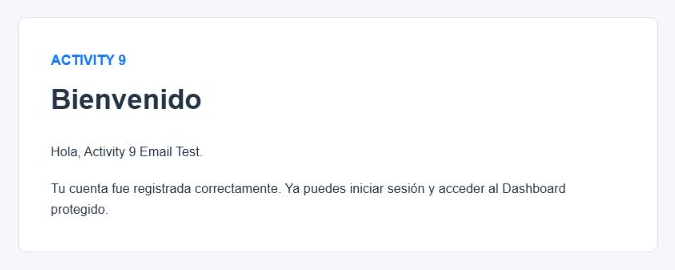
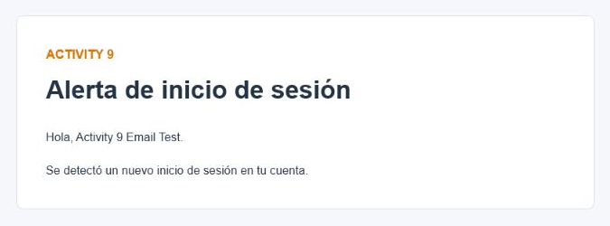

# Tarea 8

## Objetivo

Extender el mismo proyecto de la Actividad 9 con notificaciones por correo para el registro y el inicio de sesión. Cada mensaje debe enviarse a la dirección almacenada en el usuario correspondiente.

## Correo de bienvenida

El hook `registered` de `RegisterController` se ejecuta después de crear al usuario. En ese punto Laravel envía el `Mailable` `WelcomeUser` al correo registrado, con asunto **Bienvenido** y un mensaje que confirma la creación de la cuenta.

La recepción se comprobó en el buzón real configurado para el ejercicio. La evidencia está recortada al cuerpo del mensaje para ocultar la cuenta, la dirección y el resto del buzón.

## Alerta de inicio de sesión

El hook `authenticated` de `LoginController` se ejecuta después de un login explícito correcto. Laravel envía `LoginAlert` al correo del usuario autenticado, con asunto **Alerta de inicio de sesión**. El registro automático no dispara esta alerta, por lo que cada flujo mantiene su notificación correspondiente.

La recepción de la alerta también se comprobó en el buzón real.

## Seguridad

- Las credenciales SMTP permanecen únicamente en `.env`.
- `.env` está excluido mediante `.gitignore`.
- `.env.example` contiene valores vacíos o ejemplos seguros.
- Los `Mailable`, pruebas, README y documentos no contienen contraseñas, tokens ni credenciales reales.
- Las capturas de correo no muestran direcciones personales ni otros mensajes del buzón.

## Pruebas

La suite final produjo 8 pruebas correctas y 36 aserciones. Las pruebas de correo usan `Mail::fake()` para comprobar destinatario, clase y asunto sin contactar servicios externos. Además de la prueba automatizada, se realizó una verificación SMTP real:

- El registro terminó correctamente y llegó el correo **Bienvenido**.
- Después del logout, el login terminó correctamente y llegó **Alerta de inicio de sesión**.
- El usuario de prueba existe en la base `activity9` y su contraseña está hasheada.

## Evidencias

Las evidencias `08_welcome_email.png` y `09_login_alert_email.png` fueron obtenidas de los mensajes reales recibidos. Solo conservan el contenido necesario para acreditar el requisito.

## Repositorio

Actividad 9 y Tarea 8 están en el mismo repositorio:

[https://github.com/AlejandroVela333/activity-9](https://github.com/AlejandroVela333/activity-9)

## Conclusión

La Tarea 8 amplía el sistema de autenticación sin modificar archivos del framework. El proyecto envía las dos notificaciones solicitadas al correo registrado y mantiene las credenciales fuera del control de versiones.
